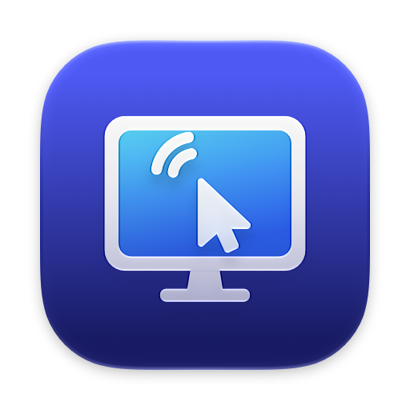
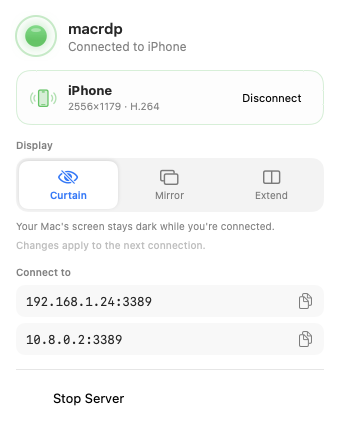
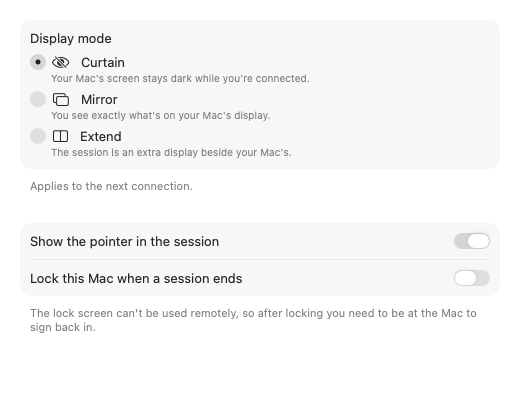

<p align="center"></p>

<h1 align="center">MacGate</h1>

<p align="center"><a href="https://github.com/0xPiPo/MacGate/actions/workflows/ci.yml"></a></p>

<p align="center"><b>A real RDP server for macOS.</b> Reach your Mac from your phone or PC with the free
Microsoft Remote Desktop / Windows App. Log in with your Mac account; the session is sized to
your device, and nobody at the desk can watch.</p>

---

## Why

On Windows, remote desktop just works. The session matches your phone's screen, it's fast, it
logs in with your Windows account, and the physical console locks while you're away. On a Mac
the built-in option is VNC: blurry, slow, a fixed resolution, and whatever you do is mirrored on
the monitor for anyone in the room.

MacGate brings the Windows experience to the Mac. It speaks standard RDP, so any RDP client
works, including the free Microsoft Windows App on iPhone, iPad and Android, mstsc on Windows,
and FreeRDP on Linux. Nothing needs to be installed on the client.

## What it does

- **Logs in with your Mac account.** It uses NLA (CredSSP) with your macOS password. Only an NT
  hash is stored, in the Keychain, and every login is re-checked against OpenDirectory.
- **Sizes the session to your device.** A virtual display is created at the client's
  resolution, so an iPhone gets a real portrait desktop, not a letterboxed 1440p one.
- **Three display modes:**
  - **Mirror:** the monitor shows what you see.
  - **Extend:** your phone gets its own extra screen.
  - **Curtain:** private. The monitor goes into standby over DDC/CI and local keyboard and mouse
    are blocked, so your session is invisible at the desk. A one-click test checks whether your
    monitor supports standby, and falls back to black-out windows when it doesn't.
- **Picks a codec per client.** Clients with H.264 get VideoToolbox hardware encoding. Clients
  without it (the iOS Windows App) get RemoteFX Progressive, encoded only for the 64×64 tiles
  that changed, with **Auto** quality that follows network congestion.
- **Low latency.** Frames are sent the moment they're encoded, with ack-based flow control, so
  slow links never build a queue.
- **Unlocks remotely.** Type your password on the lock screen from your phone, or turn on
  optional auto-unlock.
- **Close to zero idle cost.** A static screen means no encoding and no timers. With no one
  connected it uses 0% CPU.
- **Clipboard** (text, HTML, files), **audio**, drag, double-click, smooth scrolling and Unicode
  input.
- **Native SwiftUI menu-bar app** with onboarding, settings and live session stats.

<p align="center">
  
  &nbsp;
  
</p>

## How it works

```
iPhone / PC ──RDP over TLS (NLA)──▶ MacGate.app (SwiftUI)
                                      └─ macrdp-server (Rust helper, JSON Lines over stdio)
                                           ├─ IronRDP (patched): CredSSP, GFX pipeline
                                           ├─ ScreenCaptureKit + CGVirtualDisplay
                                           ├─ VideoToolbox H.264 / RemoteFX Progressive
                                           └─ CGEvent input, DDC monitor power
```

The protocol work, the security model and the bugs found along the way are covered in
**[ENGINEERING.md](ENGINEERING.md)**. Two examples: why an iPhone gets RemoteFX Progressive and
not H.264, and why turning a monitor off through WindowServer left the HDMI dark until a reboot.

## Install

Requirements: an Apple Silicon Mac on macOS 26 or later, with Xcode 27 and a Rust toolchain.

```bash
make app            # builds build/macrdp.app (Rust helper + SwiftUI app)
open build/macrdp.app
```

On first launch, onboarding asks for **Screen Recording** and **Accessibility** and your **Mac
password** (stored only as an NT hash in your Keychain). Then connect from any RDP client to
`<your-mac-ip>:3389` with your Mac username and password. The menu shows the addresses and the
TLS fingerprint to compare with the client's certificate prompt.

Optional: create a self-signed code-signing identity named `macrdp-dev`, and `make app` will use
it. Then macOS remembers permissions and Keychain access across rebuilds.

## Security

- MacGate is designed for the **LAN or a VPN such as WireGuard**. Do not expose port 3389 to the
  internet.
- Only NLA is offered; TLS-only and standard RDP security are refused. Handshakes are
  rate-limited, time-limited and capped per IP.
- No secrets are written to logs or config. The config file is created with mode 0600.
- MacGate uses private macOS APIs (virtual displays, DDC, screen lock). A macOS update can break
  them, and they keep MacGate out of the Mac App Store.

## Status

MacGate is used daily by its author with the iOS Windows App over the LAN and WireGuard. Other
clients (mstsc, Android, macOS) and WAN or cellular use are less tested. See *What is still
missing* in [ENGINEERING.md](ENGINEERING.md).

## Credits

- Based on **[x6nux/macrdp](https://github.com/x6nux/macrdp)**, whose original server, capture
  and UI code this project builds on.
- Uses **[IronRDP](https://github.com/Devolutions/IronRDP)** by Devolutions (MIT/Apache-2.0),
  with patched acceptor and server crates.
- Built by Pierre Abdelsayed with AI coding agents (Claude). I directed the architecture and
  product decisions, tested every feature live on real devices, and diagnosed the issues
  described in ENGINEERING.md.

## License

[GPL-3.0-or-later](LICENSE). The patched IronRDP crates in `crates/ironrdp-*` keep their
MIT/Apache-2.0 licenses.
